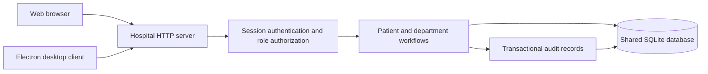

# Architecture

`server/index.js` contains the HTTP API, authentication, authorization, validation, and workflow transitions. `server/store.js` initializes the schema and password hashing. `public/` contains the browser client. `desktop/main.cjs` is the isolated desktop shell. `tests/` exercises the actual HTTP API against an isolated database.

The current server is a single process with a local SQLite database. WAL mode and foreign keys are enabled. Schema version 2 adds locations, wards, beds, inpatient admissions, staff-location assignments, stable record identities and a transactional change journal through an additive migration. Inpatient clinical access is location-scoped; outpatient scoping and actual inter-server replication remain unfinished. See [multi-location implementation status](OFFLINE-LOCATIONS.md).

All clinical events refer to one patient ID and a server-issued MRN. Encounters group notes and orders. Doctor-issued orders have a `laboratory` or `pharmacy` destination. Only staff in that destination role can complete them. Completed responses become visible in the clinical record on refresh.

The application supports structured identities and workflow states but free-text clinical notes, lab results, and prescription instructions. It does not implement clinical decision support, automatic interpretation of results, drug interactions, standardized terminology, or external health-data interoperability.

State transitions:

- Appointments: scheduled → arrived or cancelled.
- Encounters: open → closed, with a clinical note and no pending orders required.
- Orders: pending → completed, with a receiving staff member and response required.
- Invoices: unpaid → paid, with a payment reference required.
- Staff: active ↔ inactive. Deactivation deletes all sessions.

Invoices use integer minor units, currently assuming a two-decimal currency. They do not process payments. There are no partial payments, refunds, tax rules, insurance claims, or ledger postings yet.

All departmental staff in a role currently share the same hospital-wide work queue. There is no assigned-care-team access restriction or sensitive-record sealing. Read authorization and work-list scoping must become more granular before deployment where policy requires it.

The desktop renderer has Node integration disabled, context isolation and sandboxing enabled, external navigation and popup creation blocked, permissions denied, and no privileged preload bridge. These choices follow the [Electron security guide](https://www.electronjs.org/docs/latest/tutorial/security). Desktop packaging, code signing, and automatic updates remain outstanding.
